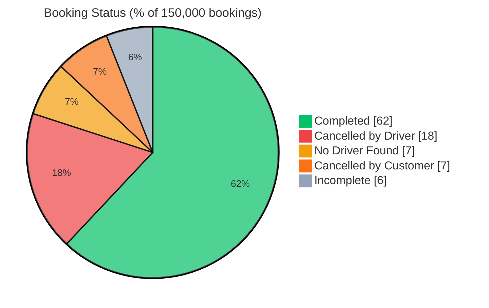

<div align="center">


<a href="https://github.com/harsh-mish">
  
</a>

<br/><br/>


<br/>


<br/><br/>

### 🚗 An end-to-end exploratory analysis of Uber ride-booking data covering **booking performance**, **cancellations**, **vehicle types**, **ride distance**, **booking value**, **ratings**, **payment methods** and **time-based patterns**.

</div>


## 🧭 Table of Contents

<div align="center">

| | Section | | Section | | Section |
|:-:|---------|:-:|---------|:-:|---------|
| 1 | [📌 Project Overview](#-project-overview) | 6 | [🔍 Analysis Performed](#-analysis-performed) | 11 | [📁 Project Structure](#-project-structure) |
| 2 | [🎯 Business Objectives](#-business-objectives) | 7 | [📈 Key KPIs](#-key-kpis) | 12 | [🎨 Visualizations](#-visualizations) |
| 3 | [🔧 Technologies Used](#-technologies-used) | 8 | [🚗 Vehicle Type Performance](#-vehicle-type-performance) | 13 | [🚀 How to Run](#-how-to-run) |
| 4 | [🔄 Project Workflow](#-project-workflow) | 9 | [💡 Key Business Insights](#-key-business-insights) | 14 | [🏁 Project Outcome](#-project-outcome) |
| 5 | [📊 Dataset](#-dataset) | 10 | [📣 Business Recommendations](#-business-recommendations) | 15 | [👤 Author](#-author) |

</div>


## 📌 Project Overview

> [!NOTE]
> This project turns **raw ride-booking records** into **clear business insights** using Python.

The analysis looks at how bookings perform from start to finish: how many rides are completed, how many are cancelled and by whom, how vehicle types compare, what booking values and distances look like, how customers and drivers rate rides, and how booking behaviour changes across the day and week.

The objective is to transform raw data into meaningful insights that help **understand operational performance** and **identify areas for improvement**.

### ⚡ At a Glance

<div align="center">


<br/>


</div>


## 🎯 Business Objectives

| | 🎯 Objective | 📝 What it answers |
|:-:|--------------|--------------------|
| 🟩 | **Booking performance** | How are bookings performing overall? |
| 🟥 | **Completion & cancellation** | What share of bookings is completed or cancelled? |
| 🟦 | **Value & distance patterns** | How do booking value and ride distance behave? |
| 🟨 | **Vehicle comparison** | Which vehicle types perform better or worse? |
| 🟪 | **Ratings** | How do customers and drivers rate their rides? |
| 🟧 | **Time-based patterns** | When do bookings peak, and how does status change by time? |
| 🟫 | **Payment & status** | Is the payment method related to booking status or value? |
| ⬛ | **Recommendations** | What actions can improve fulfilment? |


## 🔧 Technologies Used

<div align="center">


</div>

| | Technology | Used for |
|:-:|------------|----------|
| 🐍 | **Python** | Core language for the whole analysis |
| 🐼 | **Pandas** | Loading, cleaning, grouping and feature engineering |
| 🔢 | **NumPy** | Numerical operations and validation |
| 📉 | **Matplotlib** | Base charts and plots |
| 🎨 | **Seaborn** | Statistical visuals, heatmaps and pairplots |
| 📓 | **Jupyter Notebook** | Interactive, step-by-step analysis |


## 🔄 Project Workflow

```mermaid
%%{init: {'theme':'base','themeVariables':{'fontSize':'15px','lineColor':'#06C167'}}}%%
flowchart LR
    A["📥 Raw Booking Data<br/>150,000 records"] --> B["🔎 Data<br/>Understanding"]
    B --> C["🧹 Data<br/>Cleaning"]
    C --> D["🧪 Feature<br/>Engineering"]
    D --> E["📊 Exploratory<br/>Data Analysis"]
    E --> F["📈 KPI<br/>Analysis"]
    F --> G["💡 Business<br/>Insights"]
    G --> H["📣 Recommendations"]

    style A fill:#000000,color:#fff,stroke:#06C167,stroke-width:2px
    style B fill:#276EF1,color:#fff,stroke:#1D4ED8,stroke-width:2px
    style C fill:#0EA5E9,color:#fff,stroke:#0369A1,stroke-width:2px
    style D fill:#8B5CF6,color:#fff,stroke:#6D28D9,stroke-width:2px
    style E fill:#EC4899,color:#fff,stroke:#BE185D,stroke-width:2px
    style F fill:#F59E0B,color:#000,stroke:#B45309,stroke-width:2px
    style G fill:#06C167,color:#000,stroke:#047857,stroke-width:2px
    style H fill:#16A34A,color:#fff,stroke:#166534,stroke-width:2px
```




## 📊 Dataset

<div align="center">


</div>

<br/>

The dataset contains **150,000 ride-booking records** with these information groups:

| | 📋 Information | 🔧 How it is used in the analysis |
|:-:|---------------|-----------------------------------|
| 🟩 | **Booking status** | Completion and cancellation analysis |
| 🟦 | **Vehicle type** | Comparing performance across vehicle segments |
| 🟪 | **Customer and booking details** | Understanding each booking record |
| 🟧 | **Pickup and drop locations** | Location context for bookings |
| 🟨 | **Booking value** | Revenue-related patterns and KPIs |
| 🟫 | **Ride distance** | Distance patterns and relation to value |
| 🟥 | **Customer ratings** | Customer experience analysis |
| 🟥 | **Driver ratings** | Driver experience analysis |
| 🔵 | **Payment method** | Payment vs value and status |
| ⬛ | **Cancellation information** | Cancellation categories and causes |
| 🟢 | **Date and time information** | Time-based features and patterns |


## 🔍 Analysis Performed

### 1️⃣ Data Understanding

| 🔎 Check | Purpose |
|---------|---------|
| Dataset shape and structure | Know the size and columns |
| Data types | Spot columns needing conversion |
| Missing-value analysis | Find incomplete fields |
| Duplicate analysis | Detect repeated records |
| Unique-value analysis | Understand categories |
| Statistical summary | Get ranges, means and spread |

### 2️⃣ Data Cleaning

- 🧼 Missing-value handling
- 🔁 Duplicate checks
- 🔄 Data type conversion
- ✅ Data consistency checks
- 🔢 Numerical data validation

### 3️⃣ Feature Engineering

Additional analytical features were created from the booking date and time:

<div align="center">


<br/>


</div>

### 4️⃣ Exploratory Data Analysis

<table>
<tr>
<td width="33%" valign="top">

#### 🟩 Univariate

- Booking Status
- Vehicle Type
- Payment Method
- Time Period
- Day of Week
- Numerical variable distributions

</td>
<td width="34%" valign="top">

#### 🟦 Bivariate

1. Vehicle Type vs Booking Value
2. Booking Status vs Ride Distance
3. Payment Method vs Booking Value
4. Time Period vs Booking Status
5. Vehicle Type vs Booking Status
6. Ride Distance vs Booking Value
7. Driver Rating vs Booking Value
8. Customer Rating vs Booking Value
9. Hour vs Booking Status
10. Day of Week vs Booking Value
11. Ride Distance vs Vehicle Type
12. Vehicle Type vs Ratings
13. Payment Method vs Booking Status

</td>
<td width="33%" valign="top">

#### 🟪 Multivariate

- Correlation Matrix
- Pairplot
- Vehicle Type × Booking Status × Booking Value
- Time Period × Vehicle Type × Booking Status
- Day of Week × Booking Status × Booking Value

</td>
</tr>
</table>


## 📈 Key KPIs

| | 📌 KPI | 📊 Value |
|:-:|--------|--------:|
| 🟦 | **Total Bookings** | 150,000 |
| 🟩 | **Completed Bookings** | 93,000 |
| 🟩 | **Completion Rate** | 62.00% |
| 🟥 | **Cancelled Bookings** | 37,500 |
| 🟥 | **Cancellation Rate** | 25.00% |
| 🟨 | **Total Booking Value** | ₹51,846,183 |
| 🟨 | **Average Booking Value** | ₹508.30 |
| 🟧 | **Average Ride Distance** | 24.64 |
| 🟪 | **Average Driver Rating** | 4.23 |
| 🟪 | **Average Customer Rating** | 4.40 |

### 🧾 Booking Status Distribution



| | Status | Share |
|:-:|--------|------:|
| 🟩 | **Completed** | 62% |
| 🟥 | **Cancelled by Driver** | 18% |
| 🟧 | **No Driver Found** | 7% |
| 🟨 | **Cancelled by Customer** | 7% |
| ⬜ | **Incomplete** | 6% |

> [!IMPORTANT]
> Overall, **38% of bookings were not completed**, while **25%** were specifically recorded as cancellations.


## 🚗 Vehicle Type Performance

| | Vehicle Type | Bookings | Share of Bookings | Completion Rate | Cancellation Rate |
|:-:|--------------|---------:|------------------:|----------------:|------------------:|
| 🛺 | **Auto** | 37,419 | 24.9% | 61.88% | 24.92% |
| 🚙 | **Go Mini** | 29,806 | 19.9% | 62.23% | 24.92% |
| 🚘 | **Go Sedan** | 27,141 | 18.1% | 61.44% | 25.29% |
| 🏍️ | **Bike** | 22,517 | 15.0% | 62.33% | 25.10% |
| 🚖 | **Premier Sedan** | 18,111 | 12.1% | 62.13% | 24.94% |
| 🛵 | **eBike** | 10,557 | 7.0% | 62.05% | 24.91% |
| 🚐 | **Uber XL** | 4,449 | 3.0% | 62.55% | 24.48% |

**Booking volume by vehicle type**

```text
Auto           ████████████████████████████████████████  37,419
Go Mini        ████████████████████████████████          29,806
Go Sedan       █████████████████████████████             27,141
Bike           ████████████████████████                  22,517
Premier Sedan  ███████████████████                       18,111
eBike          ███████████                               10,557
Uber XL        █████                                      4,449
```

<div align="center">


</div>


## 💡 Key Business Insights

| | 💡 Insight | 📊 Evidence |
|:-:|-----------|-------------|
| 1️⃣ | **High overall non-completion** | Only 62% of bookings were completed, so 38% were not. |
| 2️⃣ | **Auto leads in volume** | Auto recorded the most bookings at 37,419, the largest vehicle segment. |
| 3️⃣ | **Uber XL completes best** | Highest completion rate at 62.55% among all vehicle types. |
| 4️⃣ | **Go Sedan cancels most** | Highest cancellation rate at 25.29%. |
| 5️⃣ | **Vehicle type is not the main driver** | Completion rates range only from 61.44% to 62.55%. |
| 6️⃣ | **Strong average ratings** | Driver rating is 4.23 and customer rating is 4.40. |

### 🔎 Insight Details

**1️⃣ High Overall Non-Completion**
The 62% completion rate means a significant **38% of bookings were not completed**. Improving booking fulfilment is an important operational opportunity.

**2️⃣ Auto Has the Highest Booking Volume**
**Auto** is the largest vehicle segment in the dataset with **37,419 bookings**.

**3️⃣ Uber XL Shows the Highest Completion Rate**
**Uber XL** has the highest completion rate at **62.55%** among the analyzed vehicle types.

**4️⃣ Go Sedan Has the Highest Cancellation Rate**
**Go Sedan** has the highest cancellation rate at **25.29%**. This segment may need additional investigation into the reasons behind cancellations.

**5️⃣ Vehicle Type Is Not the Main Driver of Booking Success**
The gap between the best and worst completion rates is only about **1.1 percentage points**. Vehicle type alone does not appear to be the primary driver of booking success. Other operational factors such as driver availability, location, demand and cancellation reasons may have a stronger influence.

**6️⃣ Strong Average Customer and Driver Ratings**
The overall average driver rating is **4.23**, while the average customer rating is **4.40**, indicating generally positive ratings among completed rides.


## 📣 Business Recommendations

| | 📣 Recommendation | 🔧 What to do |
|:-:|------------------|---------------|
| 1️⃣ | **Improve booking fulfilment** | Investigate the causes behind the 38% non-completed bookings and reduce failed booking outcomes. |
| 2️⃣ | **Investigate cancellation drivers** | Analyze customer and driver cancellation reasons separately to find the major operational causes. |
| 3️⃣ | **Monitor Go Sedan performance** | Study its cancellation patterns further, since it has the highest cancellation rate. |
| 4️⃣ | **Maintain high-performing segments** | Monitor Uber XL to understand which operational factors support its stronger completion rate. |
| 5️⃣ | **Look beyond vehicle type** | Include other operational factors in decisions (see below). |

**🎯 Factors to consider beyond vehicle type**

<div align="center">


<br/>


</div>


## 📁 Project Structure

```text
Uber-Ride-Booking-Data-Analysis/
│
├── 📓 Uber_Ride_Booking_Analysis.ipynb
├── 📘 README.md
├── 📄 requirements.txt
├── 🎨 assets/
│   └── uber_banner.svg
│
└── 🖼️ visuals/
    ├── booking_status.png
    ├── vehicle_type.png
    ├── payment_method.png
    ├── ...
    └── pairplot.png
```


## 🎨 Visualizations

<div align="center">


</div>

<br/>

The project contains **34 visualizations**. All of them are available in the `visuals` directory.

| | 🖼️ Category | | 🖼️ Category |
|:-:|------------|:-:|------------|
| 🟩 | Booking status distribution | 🟨 | Ride distance analysis |
| 🟦 | Vehicle type analysis | 🟧 | Rating analysis |
| 🟪 | Payment method analysis | 🟥 | Cancellation analysis |
| 🟧 | Time-period analysis | 🟫 | Correlation analysis |
| 🟦 | Day-of-week analysis | ⬛ | Multivariate relationships |
| 🟨 | Booking value distributions | 🟩 | KPI-based business analysis |


## 🚀 How to Run

```bash
# 1. Clone the repository
git clone https://github.com/harsh-mish/Uber-Ride-Booking-Data-Analysis.git

# 2. Move into the project folder
cd Uber-Ride-Booking-Data-Analysis

# 3. Install the required libraries
pip install -r requirements.txt

# 4. Launch Jupyter Notebook
jupyter notebook Uber_Ride_Booking_Analysis.ipynb
```

> [!TIP]
> Run the notebook cells from top to bottom so every step (cleaning, features, charts, KPIs) runs in order.


## 🏁 Project Outcome

This project demonstrates an end-to-end **Exploratory Data Analysis workflow** using Python, starting from raw ride-booking data and progressing through:

<div align="center">


<br/>


</div>

<br/>

The analysis highlights booking performance, operational patterns, vehicle-level performance, customer and driver experience, and potential areas for business improvement.


## 👤 Author

<div align="center">

### Abhishek Mishra

**B.Tech Computer Science Engineering**


<br/><br/>

<a href="https://github.com/harsh-mish">
  
</a>

<br/><br/>

*Turning data into insights and insights into better decisions.* 💡

⭐ If you find this project useful, consider giving the repository a star.


</div>
